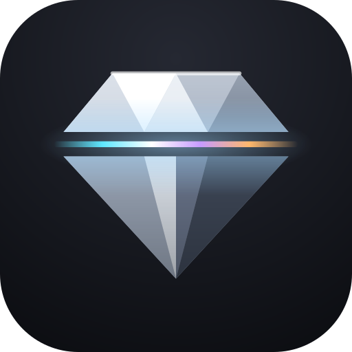
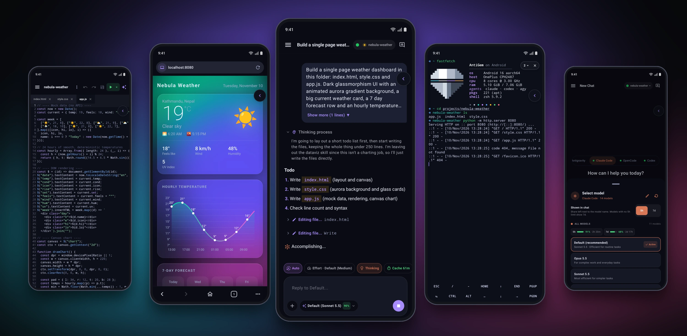
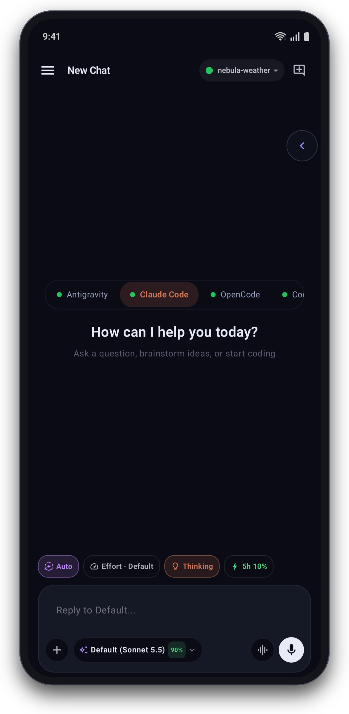
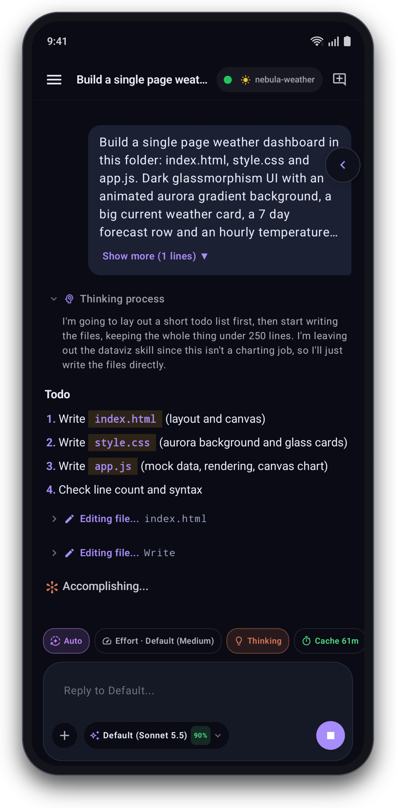
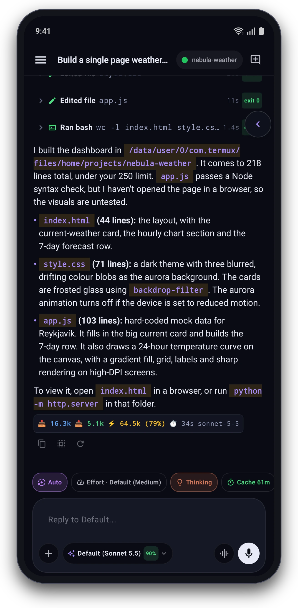
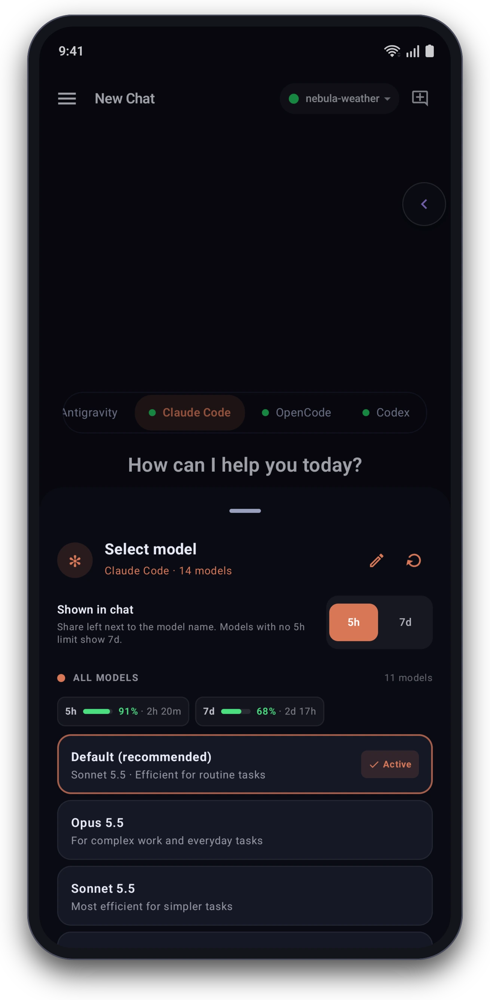
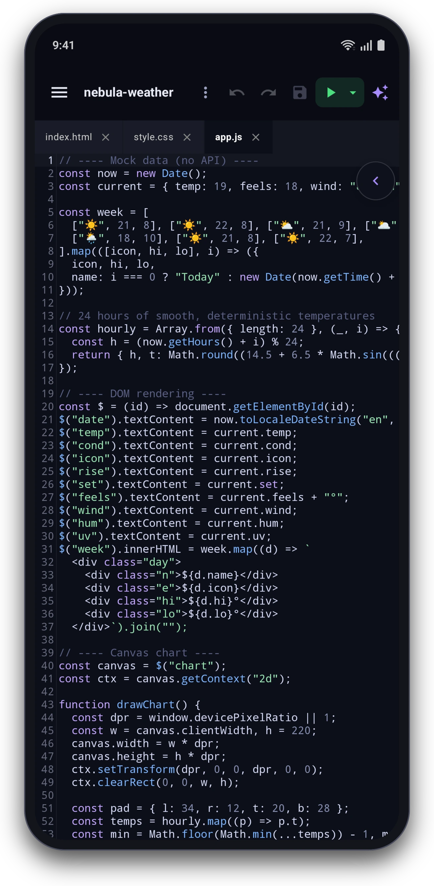
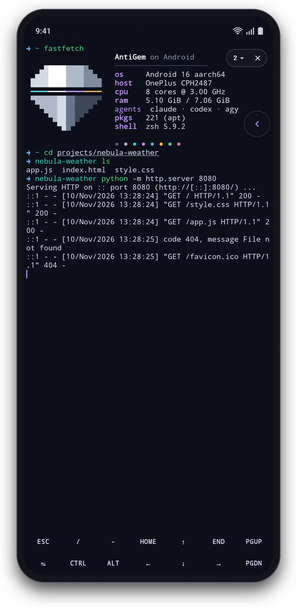
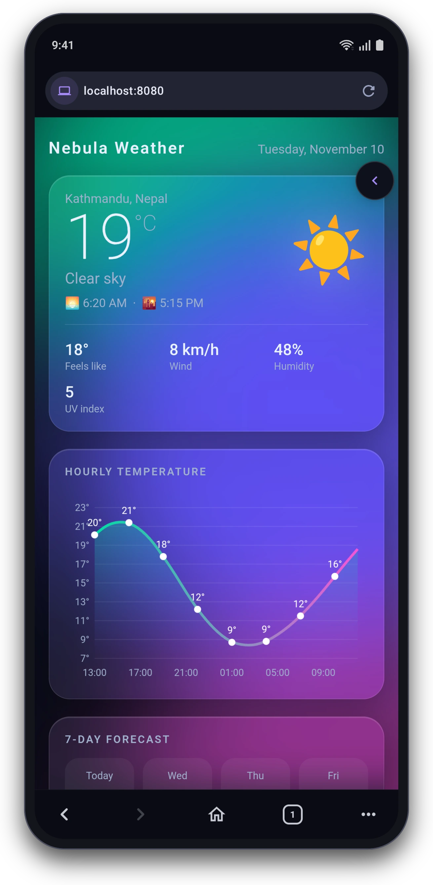
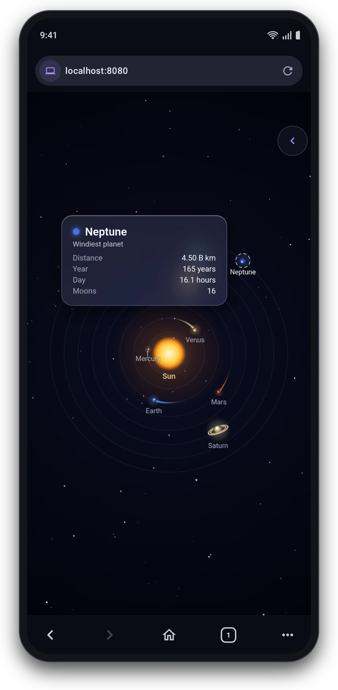

<div align="center">



# AgentOS 🤖📱

*The Autonomous AI Operating System for Android. A complete AI studio & coding environment, light enough to carry in your pocket.*

**Run Claude Code, Antigravity, OpenCode and Codex on Android with a real Linux terminal, Code Editor, In-App Browser, Video Studio, and Game Studio — all in one unified OS.**

[](https://developer.android.com/jetpack/compose)
[](https://github.com/rajnishcodex/Agent-OS)
[](https://github.com/rajnishcodex/Agent-OS)
[](LICENSE)
[](https://github.com/rajnishcodex/Agent-OS/releases/download/v2.1.0/AgentOS-v2.1.0.apk)

[📥 Download Latest APK (v2.1.0)](https://github.com/rajnishcodex/Agent-OS/releases/download/v2.1.0/AgentOS-v2.1.0.apk) · [🌐 Website](https://agentOS.rajnishcodex.shop) · [📢 Telegram](https://t.me/rajnishcodex) · [📸 Instagram](https://instagram.com/i_rajnishmaurya) · [📦 GitHub](https://github.com/rajnishcodex/Agent-OS)

<br>



</div>

---

## 🌟 What is AgentOS?

**AgentOS** transforms your Android phone into an autonomous development and creative powerhouse. It bundles full native Linux binaries, state-of-the-art AI coding agents, and dedicated studios for generative video and game development — without requiring root, PRoot overhead, or a PC.

### 🚀 Key Features

* **🤖 4 Integrated AI Agents:**
  * **Claude Code (`claude`)**: Anthropic's official CLI with stream-JSON protocol, subagents, and automated tool use.
  * **Antigravity (`agy`)**: Google's multi-agent workflow CLI natively compiled for Android.
  * **OpenCode**: Open-source multi-provider agent supporting 200+ models (Ollama, OpenRouter, DeepSeek, Kimi, GLM).
  * **Codex (`codex`)**: OpenAI's official CLI communicating via VS Code app-server protocol.
* **🎬 Video Studio (Code-Driven Animation & Rendering):**
  * Built-in 3-Step Setup: Basic Tools (FFmpeg, Node, Python) → 7 Curated Skills → AI Provider selection.
  * **7 Curated Video Engines**:
    1. **`ClaudeAnimationBase`**: 2D cartoon character rigging & animation with `p5.brush` watercolor style and mouth lip-sync visemes.
    2. **`mg-styles-15`**: 15 distinct motion-design engines (kinetic typography, fluid particle systems, cel animation).
    3. **`PDoomVideo`**: Procedural canvas music and lyric video pipeline.
    4. **`lemo-opuscar`**: Multi-scene mini-film studio with director shot sequencing and cinematic camera transitions.
    5. **`opus-video-prompts`**: High-converting visual explainer and product launch blueprints.
    6. **`awesome-opus5-5-videos`**: Master architecture and frame-stepping rendering reference.
    7. **`awesome-claude-5-5-videos`**: Curated WebGL 3D motion graphics and visual FX.
  * Direct 1080p MP4 rendering using local FFmpeg compilation.
* **🎮 Game Studio (Universal Game Generator):**
  * Built-in 3-Step Setup: Game Runtimes → Game Dev Skills Router → AI Provider selection.
  * Powered by **`gamedev-skills/awesome-gamedev-agent-skills`** with automatic engine routing.
  * **Instant Web Games (HTML5 / Phaser 3 / Three.js 3D)**: Single prompt generates a complete game that runs immediately in the built-in AgentOS browser with mobile touch joysticks.
  * **Standalone Android APKs (Godot 4 GDScript / Unity)**: Automated project generation, scene tree `.tscn` configuration, and Android APK packaging presets.
  * **3D Asset CDN Integration**: Automated fetching of 10,000+ free CC0 3D models (`.glb`/`.gltf`) from **Kenney.nl** and **Poly Pizza**.
* **⚡ Native Linux Engine (`agentos.ai`):**
  * Pure 64-bit (`arm64-v8a`) architecture.
  * Full Termux package ecosystem adapted directly for package `agentos.ai`.
  * Real Linux bash terminal with tmux, git, python, node, and clang.
* **🪟 In-App Browser & Code Editor:**
  * Full-featured code editor with syntax highlighting, tabs, and file trees.
  * Built-in Chromium-based browser with live reload and mobile touch emulation for instant game/app testing.
* **🎨 Custom Themes & MCP Server Presets:**
  * One-tap Model Context Protocol (MCP) servers (Browser Automation, Terminal, Filesystem).
  * Elegant light and dark themes with customizable accents.

---

## 📸 Screenshots & Showcase

<table>
  <tr>
    <td colspan="4" align="center"><b>🤖 Autonomous AI Agents</b></td>
  </tr>
  <tr>
    <td align="center" width="25%"><br><sub>4 Agents, 1 App</sub></td>
    <td align="center" width="25%"><br><sub>Live thinking & edits</sub></td>
    <td align="center" width="25%"><br><sub>Tool cards & token stats</sub></td>
    <td align="center" width="25%"><br><sub>Model picker & usage</sub></td>
  </tr>
  <tr>
    <td colspan="4" align="center"><b>🎬 Video Studio & 🎮 Game Studio</b></td>
  </tr>
  <tr>
    <td align="center"><br><sub>Code Editor</sub></td>
    <td align="center"><br><sub>Linux Terminal</sub></td>
    <td align="center"><br><sub>Live Browser & Game Play</sub></td>
    <td align="center"><br><sub>Three.js 3D Games</sub></td>
  </tr>
</table>

---

## 📥 Installation

1. Download the latest debug APK:  
   👉 **[Download AgentOS-v2.1.0.apk](https://github.com/rajnishcodex/Agent-OS/releases/download/v2.1.0/AgentOS-v2.1.0.apk)** (~32 MB)
2. Install the APK on your Android phone (Android 8.0+ / arm64-v8a).
3. On first launch, AgentOS downloads the verified Linux rootfs (`agentos.ai`, ~380 MB) with all essential tools pre-configured.
4. Open **Video Studio** or **Game Studio** to launch the automated 3-step setup and start creating!

---

## 🛠️ Architecture

```
┌────────────────────────────────────────────────────────────────────────┐
│                                AgentOS                                 │
├──────────────────┬──────────────────┬──────────────────┬───────────────┤
│    Claude Code   │   Antigravity    │      Codex       │   OpenCode    │
│   (Anthropic)    │     (Google)     │     (OpenAI)     │ (Multi-Model) │
├──────────────────┴──────────────────┴──────────────────┴───────────────┤
│   🎬 Video Studio (p5.brush, ClaudeAnimationBase, mg-styles, FFmpeg)   │
│   🎮 Game Studio (Three.js 3D, Phaser 2D, Godot 4 APK, Kenney 3D)     │
├────────────────────────────────────────────────────────────────────────┤
│                      In-App Browser & Code Editor                      │
├────────────────────────────────────────────────────────────────────────┤
│          Go IDE Bridge (agy_ide_bridge / relocate-debs)                │
├────────────────────────────────────────────────────────────────────────┤
│       Native Linux Rootfs (`/data/data/agentos.ai/files/usr`)          │
└────────────────────────────────────────────────────────────────────────┘
```

---

## 👨‍💻 Developer & Community

* **Developer & Maintainer:** [@rajnishcodex](https://github.com/rajnishcodex)
* **Website:** [agentOS.rajnishcodex.shop](https://agentOS.rajnishcodex.shop)
* **Telegram Group / Channel:** [@rajnishcodex](https://t.me/rajnishcodex)
* **Instagram:** [@i_rajnishmaurya](https://instagram.com/i_rajnishmaurya)
* **GitHub Repository:** [rajnishcodex/Agent-OS](https://github.com/rajnishcodex/Agent-OS)

---

## 📄 License

AgentOS is licensed under the [GNU General Public License v3.0](LICENSE).
Built with passion for autonomous mobile AI development.
